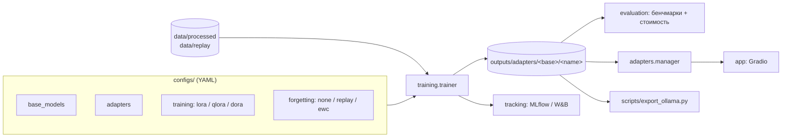

# Архитектура

> Планируемая архитектура. Кода пока нет — см. статус в README.

## Модули `src/peft_lab/`

| Модуль | Ответственность | Этап |
|---|---|---|
| `config`, `registry` | загрузка YAML, список моделей и адаптеров команды | 2 |
| `data/` | загрузка JSONL, chat template | 2 |
| `models/` | базовая модель, 4-bit квантизация | 3 |
| `training/` | LoRA / QLoRA / DoRA через PEFT + TRL | 3 |
| `forgetting/` | replay-буфер, EWC | 3 |
| `evaluation/` | бенчмарки забывания, доменные метрики, GPU/время/FLOPs | 3 |
| `tracking/` | MLflow / Weights & Biases | 3 |
| `adapters/` | загрузка, переключение, комбинирование адаптеров | 4 |
| `app/` (вне пакета) | Gradio UI | 5 |

## Принцип расширения

Новая базовая модель или адаптер добавляются **YAML-файлом**, без правки кода.
Реестр (`registry`) будет находить их автоматически, а тесты — проверять корректность.
